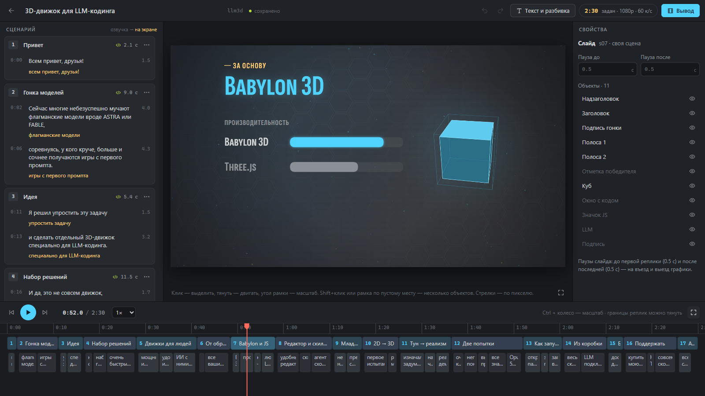

# PresBuilder

Анимированные ролики из текста озвучки. Вставляешь текст — он сам режется на слайды и реплики
по времени, а сцены рисует ИИ-агент (Claude Code или Codex). Ты правишь текст, тайминги и
положение объектов в редакторе и получаешь MP4 1080p/4K.

*Animated explainer videos from a voice-over script: an editor plus scenes written by an AI agent.*



## Запуск

Нужны [Node.js](https://nodejs.org) 22.18+ и Chrome или Edge.

```bash
git clone https://github.com/xaidan777/PressBuilder
cd PressBuilder
npm install
npm run dev
```

На Windows — двойной клик по `PresBuilder.bat`. Редактор откроется на http://localhost:5180.

## Как сделать ролик

1. **Новая тема** в редакторе: заголовок и текст озвучки.
2. Открой папку проекта в **Claude Code** или **Codex** и скажи: `делай тему <id>`.
   Агент нарисует сцены по скиллу `presbuilder`, редактор подхватит их сразу.
3. Поправь текст, тайминги и объекты, нажми **«Вывод»** → `out/<id>.mp4`.

Примеры с готовыми сценами: `atlas-converter`, `llm3d`, `hexstorm`.
Подробно — в [руководстве](docs/guide.md).

## Лицензия

[MIT](LICENSE)
